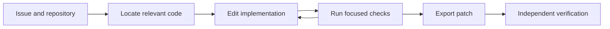

# Gemma Agent Lab

[](https://github.com/jwj1342/gemma-agent-lab/actions/workflows/ci.yml)

**Research and reproducible experiments for reliable open-model coding agents.**

A collaborative workspace for the [Gemma 4 Developer Agent Competition](https://www.kaggle.com/competitions/gemma-4-developer-agent), exploring how agents locate relevant code, use tools, and repair real software issues.

[Getting started](#getting-started) · [Results](#verified-results) · [Documentation](#documentation) · [Contributing](CONTRIBUTING.md) · [Kickoff slides](https://www.overleaf.com/project/6ac31a4a617496d875323ad8)

**New to the workspace?** Use the [repository map](docs/repository-map.md) to find files and the
[Kaggle walkthrough](docs/kaggle-runtime.md) to run our baseline with your own account.
For repeated method comparisons on our prepared H100 environment, use the
[local evaluation guide](docs/local-evaluation.md): fixed cohorts, one model startup per batch,
cached environment controls, resumable results, and paired reports.

## 🔬 Research focus

We develop and evaluate agents built on the competition's required Gemma 4 base. The submitted baseline runs without a LoRA adapter. A [first SWE/graph LoRA pilot](docs/first-lora.md) completed training, checkpoint recovery, official quantized serving, and one-task repair verification. Broader repair and graph gains remain open research questions.

| Direction | Research question |
| --- | --- |
| Code localization | Can source search and code graphs find useful context within a limited budget? |
| Tool use and repair | Can better tool selection, concise plans, and targeted checks produce more reliable patches? |
| Evaluation | Which improvements survive matched-task comparisons and independent verification? |
| Model adaptation | Can verified repair trajectories support useful parameter-efficient fine-tuning? |



<a id="verified-results"></a>

## 📊 Verified results

The submitted baseline uses `gemma-4-31b-it-qat-w4a16-ct` with no LoRA. The following are recorded results, last updated on **October 9, 2026**.

| Evaluation | Result | Evidence |
| --- | --- | --- |
| Official competition submission | **0.12 public score**, submission `56844353` complete; private score unavailable | [Submission record](resource/manifests/competition-result.json) |
| Kaggle L4×4 smoke test | `rich_3454` resolved; **84 tests passed**, including one added regression test | [L4 run](resource/manifests/kaggle-runtime-smoke.json) |
| Independent H100 smoke test | The same public task passed compilation, offline generation, and patch verification | [H100 run](resource/manifests/hpc-smoke.json) |
| First LoRA pilot on H100 | 64 SFT updates across two phases; corrected agent completed `rich_3454` with **84 passed tests** | [Pilot report](docs/first-lora.md) |
| Fixed local development cohort | Baseline **4/11**, first LoRA **2/11**, with **11/12 control coverage**; cached controls avoid about 18 minutes of repeated checks | [Batch evaluation](docs/experiments/2026-10-09-local-evaluation.md) |

Controls reproduced the original failure (**1 failed / 82 passed**) and confirmed the reference patch (**83 passed**). On L4×4, the agent phase took **74.10 seconds**, excluding model startup; the notebook reached smoke completion in about **655 seconds**.

These smoke tests cover one public task. They do not establish full-benchmark performance, a LoRA advantage, graph utility, or compliance with the global runtime budget. See the [submission guide](docs/submission.md) and [LoRA report](docs/first-lora.md) for evidence and remaining work.

The local development cohort uses public tasks and H100 resources. Its resolution rate is separate
from the competition leaderboard; evaluating a new method still requires fresh inference and grading.

<a id="getting-started"></a>

## 🚀 Getting started

You can begin on a regular laptop. The packaging check below uses only Python 3.10+ and its standard library; GPU experiments can run in a Kaggle notebook.

### 1. Clone the workspace

Accept your private-repository invitation and sign in with GitHub CLI:

```bash
gh repo clone jwj1342/gemma-agent-lab
cd gemma-agent-lab
```

### 2. Check the baseline package

```bash
python3 scripts/build_submission.py \
  --agent-dir configs/baseline \
  --output runs/local-packaging/submission.zip
```

This creates a reproducible ZIP and a file-hash manifest. It does not run a model or upload a competition submission.

### 3. Run your first agent experiment

Generate a private Kaggle notebook from the team's baseline. Replace the owner with your Kaggle username:

```bash
python3 scripts/prepare_kaggle_runtime.py \
  --owner YOUR_KAGGLE_USERNAME --slug gemma4-first-smoke \
  --agent-dir configs/baseline --task-id rich_3454 \
  --output runs/first-kaggle-smoke/notebook
```

This prepares files locally using only Python's standard library. The notebook reads data and weights
from Kaggle Inputs when it runs. Follow the [Kaggle walkthrough](docs/kaggle-runtime.md) to check
quota, launch L4×4, and inspect results. The [official starter](https://www.kaggle.com/code/ryanholbrook/getting-started-gemma-4-developer-agent)
is also available for a browser-first introduction.

For a first contribution, open an Issue with a small hypothesis, make one change on a branch, and compare it against the baseline. The [contribution guide](CONTRIBUTING.md) explains the PR workflow and experiment records.

If an official dependency update stops notebook preparation, see the
[wheelhouse update guide](docs/wheelhouse-updates.md). Known snapshots are accepted
automatically; `--wheelhouse-mode record` enables a documented exploratory update.

## 🗂️ Repository structure

| Path | Purpose |
| --- | --- |
| [`configs/`](configs/) | Baseline agent, experiment settings, and environment specifications |
| [`scripts/`](scripts/) | Packaging, collection, validation, and execution utilities |
| [`tests/`](tests/) | Lightweight checks for notebook preparation; no GPU required |
| [`src/`](src/) | Team implementations and future agent/training extensions |
| [`docs/`](docs/) | Competition guides, research findings, and execution plans |
| [`resource/`](resource/) | Reference snapshots, reading notes, provenance, and small evidence manifests |
| [`data/`](data/) | Local original and processed datasets; large files excluded from Git |
| [`model/`](model/) | Local base weights and adapters; large files excluded from Git |
| [`runs/`](runs/) | Local logs, outputs, caches, and checkpoints; artifacts excluded from Git |

<a id="documentation"></a>

## 📚 Documentation

| Start with | Then explore |
| --- | --- |
| [Repository map](docs/repository-map.md) | Where each maintained file belongs and how the run paths connect |
| [CI and review](docs/ci-and-review.md) | Lightweight checks, one-person review, and branch-protection status |
| [Kaggle runtime](docs/kaggle-runtime.md) | Prepare and run our agent without local data or a local GPU |
| [Competition overview](docs/overview.md) | Task, scoring, submission contract, and constraints |
| [Data guide](docs/data.md) | Schemas, snapshots, graph inputs, and label separation |
| [Participation](docs/participation.md) | Kaggle setup, compute quota, and team access |
| [Research report](docs/competition-research.md) | Findings from official material and public approaches |
| [Resource index](resource/README.md) | Official pages, 112 notebook reviews, discussions, models, and leaderboard snapshot |
| [Submission guide](docs/submission.md) | Packaging, validation, official upload, and result tracking |
| [Training plan](docs/training-plan.md) | Proposed SFT/LoRA work, compatibility checks, and prerequisites |
| [First LoRA](docs/first-lora.md) | SWE-smith trajectories, grounded graph demonstrations, SFT, recovery, and evaluation gates |
| [Complete SWE LoRA run](docs/swe-lora-v1.md) | Research-based configuration, corpus construction, full epochs, and submission gates |
| [Local evaluation](docs/local-evaluation.md) | Frozen public cohorts, batch inference, cached controls, and method comparisons |
| [Trillium runtime](docs/cluster-runtime.md) | Optional cluster-specific environment and execution instructions |

The [32-page kickoff presentation](https://www.overleaf.com/project/6ac31a4a617496d875323ad8) introduces coding agents, the competition, research directions, and team workflows. It is maintained separately in Overleaf and is excluded from this repository.

## 🤝 Reproducibility and collaboration

- **Keep comparisons explicit.** Record code/configuration revisions, task splits, model/data versions, seeds, resources, timing, and measured outcomes.
- **Separate inputs from answers.** Reference patches and validation labels stay outside agent inference inputs.
- **Share compact evidence.** Commit reports and manifests; keep datasets, weights, full logs, checkpoints, and credentials in their appropriate private storage.
- **Review changes together.** Use feature branches, [Issues](https://github.com/jwj1342/gemma-agent-lab/issues), and [pull requests](https://github.com/jwj1342/gemma-agent-lab/pulls). Coordinate official submissions across the team.

A clone does not include model weights, competition archives, local environments, or historical run outputs. Existing Trillium paths refer to the maintainer's workspace, `/scratch/jwj/kaggle_gemma4_agent`; other accounts need their own setup. GitHub access, Kaggle team membership, and cluster permissions are independent.

## Sources and attribution

The reference collection dates to **October 4–5, 2026**. Rules, rankings, packages, and quotas may change; check current official guidance before running new experiments. Public notebook reviews are static analysis, not independent reproductions of every author's claims.

Team-authored documentation and navigation use English. Original third-party sources, quoted metadata, and names retain their source language and attribution. See [THIRD_PARTY_NOTICES.md](THIRD_PARTY_NOTICES.md) for licensing boundaries and asset provenance. No repository-wide open-source license has been selected for the team's original work.
