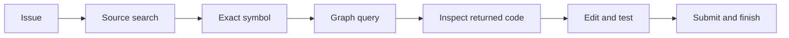

# First SWE and graph LoRA

Track the experiment in [Issue #4](https://github.com/jwj1342/gemma-agent-lab/issues/4)
and review the implementation in [PR #3](https://github.com/jwj1342/gemma-agent-lab/pull/3).
The follow-up [local evaluation workflow](local-evaluation.md) freezes public cohorts and batches
inference with reusable environment controls. It separates repeated development from milestone holdout use.

The first experiment uses successful SWE-smith trajectories to train repository repair actions and
executed competition graph queries to train graph-tool arguments. It is a bounded SFT pilot. Its
export and recovery checks are separate from any claim about issue-resolution gains.

## Measured pilot

Job `1053959` completed 32 optimizer updates on one H100 and successfully resumed in a fresh
process from step eight, restoring adapter, optimizer, and RNG state. The rank-8 adapter has
10,956,800 trainable parameters, 220 saved tensors, 110 nonzero B matrices, and a 43,859,880-byte
weight file. Peak allocated GPU memory was 65.08 GiB. Evidence is in
[the compact manifest](../resource/manifests/first-lora.json).

| Fixed held-out action samples | Before SFT | After SFT |
| --- | --- | --- |
| SWE assistant-token NLL, 16 actions / 617 tokens | 1.2954 | 0.7231 |
| Graph assistant-token NLL, 16 actions / 582 tokens | 1.3092 | 0.5269 |

These are likelihood measurements on complete tool actions, not repair scores. A fixed graph action
changed by 0.5256 NLL when enabling the learned adapter. Official quantized-vLLM loading and a
reserved-task repair are separate checks. The original official public score remains 0.12.

### Initial export: useful negative result

Job `1054006` loaded the adapter in the official quantized vLLM environment. In eight fixed contexts,
the base/adapter emitted schema-valid tools on 4/3 SWE cases and 3/4 graph cases. Expected-tool
matches were 3/3 SWE and 3/2 graph cases. One adapter edit hit the diagnostic's 512-token output
limit and remained unparsed. These tiny prescribed-action checks demonstrate loading; they do not
establish an overall tool-use improvement, and alternative actions can also be reasonable.

On reserved `rich_3454`, job `1053994` produced a 1,160-byte patch, then called `submit_patch`
62 times and exhausted the 80-turn limit. It used 15 budget-counted tools and made no graph calls.
Independent diagnostic verification in job `1054042` found **84 tests passed** for that patch.
The original inference still failed. The harness requires a final assistant reply after submission,
whereas most SWE-smith demonstrations end at their upstream `submit` action without an observation.

### Submission-protocol correction

The correction starts from the saved initial adapter with a **fresh optimizer** and a new frozen
data/configuration contract; it is distinct from resuming an interrupted run. Each phase separately
checks full-state recovery at step eight.

`prepare_terminal_sft.py` executes official test, submission, and optional status tools against 128
controlled temporary Git fixtures. The resulting 109 training and 19 validation examples contain real
tool observations and a team-authored final answer, `The patch is submitted.` The native `<turn|>`
stop token receives loss. These are protocol examples, with no claim of solving real SWE issues.
They do not use the reserved task, its patch, or its trace as training data.

The correction uses 32 updates, sampling 25% SWE, 25% graph, and 50% terminal examples. It preserves
true upstream final messages only at the end of a trajectory following an observed submission;
intermediate comments cannot truncate later actions. Original and corrected weights/traces remain
separate so that a lower training loss cannot hide the observed failure.

| Correction validation | Before correction | After correction |
| --- | --- | --- |
| SWE NLL, 16 actions / 1,619 tokens | 0.7669 | 0.6517 |
| Graph NLL, 16 actions / 582 tokens | 0.5269 | 0.2550 |
| Terminal NLL, 16 fixtures / 112 tokens | 5.2587 | 0.000647 |

Training job `1054072` passed save/resume and export checks with 65.18 GiB peak allocated memory.
The terminal target is deliberately simple and repeated across fixtures. Its very low loss measures
protocol imitation on those contexts, with no implication of broad repair generalization. SWE validation
selection changed with the corrected metadata; compare rows within a phase, rather than comparing
the first table's 617-token SWE sample directly to this table's 1,619-token sample.

The corrected quantized serving check emitted a clean final answer on all four held-out protocol
fixtures; the base also passed all four. Graph tool schemas were valid on 4/4 adapter contexts versus
3/4 base contexts, with 3/4 expected-tool matches for each. SWE contexts had 3/4 versus 4/4 parsed,
schema-valid tools; an adapter edit again hit the 512-token diagnostic limit. This is a compatibility
and control-flow check, rather than evidence that the adapter beats the base on SWE repairs.

The same job completed the full official-harness smoke on reserved `rich_3454`: valid empty/gold
controls, clean nonempty generation, a final assistant reply, and **84 independently passed tests**.
It took **41.65 seconds** for inference, excluding model startup, used 13 budget-counted tools and
15 LLM calls, and submitted once. All three edits had the correct argument schema; one targeted test
initially failed and the agent corrected its added regression case. It made no graph calls.

This task was already resolved by the baseline. The baseline prompt, sampling configuration, and
budget were preserved, with only the root agent routed to the adapter; the analyzer remained on the
base. Sampling is stochastic and this is a single known-task run. It validates corrected operation,
without establishing a faster agent, better repair rate, or positive graph contribution.

The local export is `model/adapters/first-swe-graph-lora-pilot/`, SHA-256
`7a5f5f4a90487565e56f776fd4317263179d12bd8449cc8e62a2cdedf1f37732` for
`adapter_model.safetensors`. The frozen agent ZIP is under
`runs/20261007-first-lora-corrected-rich3454/inputs/`. Weights, raw trajectories, and complete traces
are local ignored artifacts; the measured manifest and implementation are versioned for team review.

## What the current public score means

Our official submission scored **0.12**. The October 7, 2026 authenticated leaderboard export contained
1,982 scored teams: median **0.10**, maximum **0.24**, 375 teams at **0.12**, and 356 strictly above it.
Our score is above the median, with a large tie. The board alone cannot distinguish model reasoning,
agent policy, timeouts, tool errors, and task difficulty.

The [official Data description](https://www.kaggle.com/competitions/gemma-4-developer-agent/data)
describes 129 public development tasks and about 120 hidden evaluation tasks from private repositories,
split approximately evenly between public and private scoring. This differs from SWE-bench Verified.
Every competition agent uses the same 31B QAT base, and the complete inference phase has a 12-hour
budget including sandbox setup. Comparisons with frontier-model agents, larger budgets, or multiple
attempts require those differences to be stated.

The [SWE-smith paper](https://arxiv.org/abs/2504.21798) reports **40.2% Pass@1** on SWE-bench Verified
for SWE-agent-LM-32B. The [SWE-Gym paper](https://arxiv.org/abs/2412.21139) reports **32.0%** on Verified
when combining its trained agent with verifier-based inference scaling. These results support trajectory
training as a research direction; they do not predict the score of a Gemma LoRA under this competition harness.

Our completed H100 and L4 traces cover only `rich_3454`. Neither used a graph tool or the analyzer
subagent. The H100 trace repeated an `edit_file` call four times without the required `old_string`.
The baseline prompt targets 8–10 turns and its configured per-task limit is four minutes. These are
concrete reasons to investigate tool reliability and agent policy alongside training. We do not have
the formal submission's per-task failure traces, so their contribution to 0.12 remains unknown.

## Training data

| Source | Pilot use | Evidence boundary |
| --- | --- | --- |
| [SWE-smith tool trajectories](https://huggingface.co/datasets/SWE-bench/SWE-smith-trajectories) | 128 unique successful issue trajectories, selected deterministically from one pinned shard | Success is the upstream `resolved=True` label; competition-tool replay is pending |
| Competition public graphs | 16 repository snapshots, four symbols each; official neighbor, subgraph, and cached-vector tools are executed | Component demonstrations teach graph interactions; they are not successful repair trajectories |
| SWE-Gym SFT trajectories | Candidate for expansion; 491 formatted successful demonstrations | Inline XML needs conversion and task provenance reconstruction |
| SWE-Gym sampled trajectories | Candidate after license clarification | Current raw dataset metadata does not declare a license; keep separate from the MIT SFT dataset |

The SWE-smith source is pinned to revision `08e109b4a59eaeebf80e4675cd125d42e7ac99a4` and
`data/tool-00004-of-00008.parquet`, SHA-256
`e41ffbd3f9d1571917ac5b9f4d0108ded4799d9776f597a054203467135a5715`.
The current card declares MIT. Its current `tool` split has 24,100 rows; the older card prose describes
the 5,017 trajectories used in the paper. The XML, ticks, and tool exports should not be added together
as unique issues. Selecting one shard limits coverage; this pilot is not the full training corpus.
The selected 128 trajectories cover 30 repositories and use `claude-3-5-sonnet-20241022` as the
recorded teacher. There are 23 training snapshot groups and seven validation groups.

`bash` maps to `run_command`; editor view/create/replacement map to `read_file`, `write_file`, and
`edit_file`; submit maps to `submit_patch`. Unsupported editor actions and invalid observation links
are rejected. Workspace paths are normalized. Original observation text is retained; no native
tool response, exit status, or successful target-environment execution is invented.

The measured pilot retained upstream dependency setup actions. A subsequent, **untrained** candidate
uses `--reject-setup-actions` to discard whole trajectories containing explicit install, package-manager,
clone, or download commands. On the same pinned shard it yields 109 trajectories, 933 training actions,
and 272 validation actions. The heuristic filters explicit shell command boundaries; it does not establish
offline executability. Future training should use the stricter candidate and replay suitable trajectories
in the target environment. This new candidate did not retroactively change the measured pilot's inputs.

Splits share a repository and base-commit key across both sources. Multiple mutations or attempts on
the same snapshot stay together. The historically tested `rich_3454` snapshot is reserved entirely.
Reference fixes and hidden validation tests are never added to model inference prompts.
Different commits can still share source code, including later fixes. Snapshot grouping prevents
identical-snapshot overlap; a broader generalization study should hold out complete repositories
and/or time ranges. The reserved `rich_3454` check is a compatibility smoke test on a known task.

Graph demonstrations use exact symbol IDs, lowercase `calls`, returned neighbor IDs, and actual
induced-subgraph results. A genuinely missing ID produces an empty response before the model is
supervised to fall back to source search. Similar-code examples query existing cached symbols.
This does not assume the current tool can embed arbitrary natural-language queries. To measure graph
utility, compare an identical agent and adapter with graph tools enabled and disabled on held-out repairs.

## What an expanded trajectory dataset should teach

The current graph component gives the agent a symbol ID explicitly. It teaches API use and fallback,
but not issue-to-symbol localization or deciding whether a graph query is worth its cost. SWE-smith
trajectories do not contain this competition's graph tools. Changing tool names alone cannot add that
missing behavior. A useful next corpus should record the entire chain in the competition harness:



Generate several teacher attempts per training issue, independently verify patches, and retain
successful trajectories plus successful recoveries from empty graphs, ambiguous edits, and failing
targeted tests. Keep actual observations and failure categories. The
[official SWE-smith training guide](https://swesmith.com/guides/train_swe_agent/) follows expert
rollouts, evaluation, successful-trajectory selection, SFT, and independent evaluation. That is a
practical next stage before online reinforcement learning.

Use a larger repository-held-out repair set for baseline, SWE-only, and SWE+graph comparisons. The
same graph-enabled/disabled comparison isolates tool availability. Record resolution, clean completion,
invalid arguments, graph calls, runtime, and budget exhaustion. Counting more graph calls alone is
not evidence of benefit; forcing a graph query can consume time without helping the fix.

## Model and objective

The [compressed-tensors loading documentation](https://huggingface.co/docs/transformers/quantization/compressed_tensors)
supports dequantizing stored weights for dense fine-tuning. We use the already downloaded official v2
checkpoint, dequantize it to BF16 in Transformers, freeze the base, and train rank-8 LoRA on text
attention `q_proj` and available `v_proj` layers. This avoids substituting a differently trained base.
The H100 forward/backward probe passed with 110 target modules and 60.86 GiB peak GPU allocation.

The objective supervises complete assistant tool actions in Gemma's native chat template. Prompt,
user, and observation tokens are masked. The template's pending tool-response marker is excluded
from assistant loss. Examples retain the issue and recent complete action/observation turns; long
excerpts are marked and examples that cannot fit are skipped. The pilot uses at most 4,096 tokens,
32 optimizer steps, four actions per update, and a 75% SWE / 25% graph sampling mix.
The correction additionally supervises final replies; its distinct sampling mix is described above.

The mixture trains schema correctness, focused commands, exact edits, and graph lookup/fallback.
It does not yet supervise full long-horizon trajectories or prove improved repair success. A later
dataset should run an expert in the actual competition harness, retain successful repairs and useful
recovery segments, and group independent evaluations before increasing the training budget.

## Reproduce on Trillium

Keep the training environment separate from evaluation. Load fixed modules before activation:

```bash
module load StdEnv/2023 python/3.12.4 cuda/12.9
virtualenv --no-download "$HOME/venvs/gemma4-train"
source "$HOME/venvs/gemma4-train/bin/activate"
python -m pip install --no-index -r configs/training/requirements.txt
```

Download the pinned parquet on a datamover. Load `arrow/25.0.0` before activating the environment
when preparing parquet data; PyArrow is provided by that module, rather than a wheelhouse pip install.
Use new output paths to preserve earlier evidence:

```bash
bash scripts/download_swesmith_pilot.sh
# Return to a login node for lightweight preparation; load modules before activation.
module load StdEnv/2023 python/3.12.4 cuda/12.9 arrow/25.0.0
source "$HOME/venvs/gemma4-train/bin/activate"
python -m scripts.prepare_sft_data \
  --parquet data/raw/swesmith/tool-00004-of-00008.parquet \
  --output data/processed/first-swe-graph-lora --max-trajectories 128
python scripts/prepare_lora_run.py --run-dir runs/YYYYMMDD-first-lora
sbatch --account=YOUR_ACCOUNT --partition=debug \
  --output="$SCRATCH/gemma-lora-%j.log" \
  scripts/slurm_first_lora.sh "$PWD" "$PWD/runs/YYYYMMDD-first-lora"
```

The debug partition is for this bounded pilot; omit it for regular training. The current launch script
uses the maintainer's HOME environment paths and staged official assets. Teammates must prepare
their own paths before using it. Compute jobs remain offline and write caches/checkpoints to SCRATCH.

The runner freezes code/configuration, checks data/base hashes, trains eight steps, saves the adapter
with optimizer and RNG state, then starts a fresh process and resumes to step 32. It exports PEFT
safetensors, verifies nonzero learned updates, and compares fixed-input outputs with the adapter
enabled and disabled. Keep `run-manifest.json`, per-step metrics, `resume-check.json`, checkpoints,
validation results, and `training-result.json` together.

For the correction, construct a new dataset with the current converter, freeze the correction config,
and provide the first phase's adapter as the fourth launch argument:

```bash
python -m scripts.prepare_sft_data \
  --parquet data/raw/swesmith/tool-00004-of-00008.parquet \
  --output data/processed/first-swe-graph-lora-v3 --max-trajectories 128
python scripts/prepare_lora_run.py \
  --run-dir runs/YYYYMMDD-lora-correction --config configs/training/first-lora-recovery.json
sbatch --account=YOUR_ACCOUNT --partition=debug \
  --output="$SCRATCH/gemma-lora-correction-%j.log" \
  scripts/slurm_first_lora.sh "$PWD" "$PWD/runs/YYYYMMDD-lora-correction" \
  "$PWD/data/processed/first-swe-graph-lora-v3" "$PWD/runs/YYYYMMDD-first-lora/train/adapter"
```

The launch script creates controlled terminal fixtures in the isolated evaluation environment, then
trains in the separate HOME training environment. Optional `--init-adapter` initializes a new training
phase; `--resume` restores optimizer/RNG state under an unchanged contract. Use the same initialization
argument when resuming a correction. Artifact hashes, rather than identical calendar paths, establish
input identity.

## Evaluation gates

1. Check complete actions, correct loss boundaries, finite gradients, nonzero updates, save, and resume.
2. Compare fixed held-out assistant-token NLL separately for SWE and graph examples. NLL is not a repair score.
3. Load the exported adapter in the official patched vLLM with the quantized v2 base. Confirm requests
   use the adapter and that it changes outputs or token probabilities.
4. Run valid empty/gold controls and an adapter repair on the reserved snapshot. This is a smoke test.
5. Compare baseline, SWE-only LoRA, and SWE+graph LoRA on the same larger grouped holdout and budget;
   separately ablate graph tools. Record resolution, timeout, invalid arguments, empty patch, and runtime.

Competition uploads remain manual. Exported weights, raw trajectories, caches, and checkpoints stay
outside Git; commit code, provenance, and compact measured reports. Follow the team's PR and review policy.
