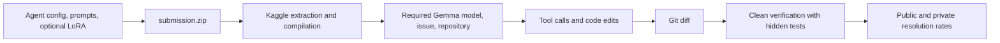

# Competition overview

Official snapshots: [Description](../resource/competition/description.md),
[Evaluation](../resource/competition/evaluation.md), [Rules](../resource/competition/rules.md),
and [Model and harness rules](../resource/competition/model-selection-budget-and-harness-rules.md).
This guide interprets the October 4–5, 2026 snapshot. Current official rules and explicit organizer
clarifications take precedence if a conflict appears.

## Objective

Given an issue and a historical version of a real Python repository, a Gemma 4 agent
locates relevant code, changes the implementation, checks its work, and submits a Git diff.
Participants can change prompts, ADK agent structure, skills, or optional LoRA adapters.
The submission is an agent ZIP that Kaggle executes on hidden tasks.

Every agent and subagent must use `gemma-4-31b-it-qat-w4a16-ct`, with optional different adapters.
Other Models-page entries or locally supported model sizes do not extend the approved scoring models.
A baseline without an adapter can establish the complete submission path.

## Scoring

For each issue, the agent generates a patch. A clean verification environment applies the
patch and hidden validation tests. A passing issue scores 1; otherwise it scores 0.
The leaderboard reports the fraction resolved. The public dataset contains 129 tasks;
the hidden set contains approximately 120, split roughly evenly between public/private scoring,
and comes from private repositories. Strategies tailored only to the four public repositories may not generalize.

Public reference patches and test patches support training or independent verification;
keep them out of inference inputs. Record environment failures separately from incorrect repairs,
especially when public tests have incomplete dependencies.

## Resources and limits

- Scoring hardware: four L4 GPUs, 24 GB each; total context limit: 32,768 tokens.
- All tasks share a 12-hour patch-generation budget, including environment setup and excluding subsequent patch verification.
- `eval_config.yaml` exposes `timeout_seconds`, `max_tool_calls`, `max_time_minutes`, and
  `max_turns`. Per-task budgets must also fit the global limit.
- Conservatively keep the expanded submission below 3 GiB, with `agent.yaml` at the ZIP root.
- Use approved extensions and safetensors adapters. Exclude pickle weights, the base model, and training environments.
- L4 notebooks must be attached to this competition with Internet disabled. Development sessions
  currently consume GPU quota at twice the reference rate; this quota and the scoring time limit are distinct constraints.
- Use harness tools, configured agent tools, and sandbox skills. Submitted Python cannot act as an arbitrary host entry point.

## Participation

The prediction competition offers $65,000; the separate paper track offers $35,000.
The optional paper deadline is November 12, 2026; prediction entry/team merger closes November 25;
final submissions close December 2. Official deadlines use 23:59 UTC unless stated otherwise.
The snapshot allows up to five members, one prediction submission per day, and two final selections.
The account snapshot shows prediction-track membership and no paper-track membership; recheck before acting.

Next: [participation](participation.md), [data](data.md), and [research findings](competition-research.md).
