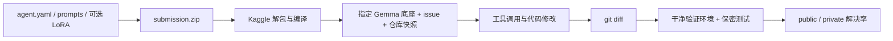

# 比赛 Overview 导读

官方原文完整快照：[Description](../resource/competition/description.md)、
[Evaluation](../resource/competition/evaluation.md)、[Rules](../resource/competition/rules.md)、
[模型与 harness 规则](../resource/competition/model-selection-budget-and-harness-rules.md)。
本页是中文操作解读；规则冲突以当前官方页面及明确的主办方澄清为准。

## 我们要做什么

给定真实 Python 仓库的旧版本和一个 issue，让 Gemma 4 agent 自己找代码、修改实现、
验证并提交 git diff。参赛者可以调整提示词、ADK agent 结构、skills，或训练 LoRA。
提交物是描述 agent 的 ZIP；Kaggle 在隐藏任务上启动它。无需预先生成隐藏题答案。

正式底座统一为 `gemma-4-31b-it-qat-w4a16-ct`。每个 agent/subagent 使用同一底座，
可各自使用不同的可选 adapter。Models 标签下的其他模型和本地 CLI 支持的其他尺寸
不代表正式评分允许使用。无 adapter 的合法基线可用于首先验证提交链路。

## 什么决定得分

每题先运行 agent 生成补丁，再在干净环境应用补丁及保密验证测试；通过为 1，否则为 0。
排行榜展示解决比例。训练集有 129 题，隐藏集约 120 题，public/private 约各一半；
隐藏题来自私有仓库。对公开四个仓库硬编码策略，未必能泛化到隐藏集。

公开数据的 gold patch/test patch 用于训练或独立验证，不能混入解题输入。
本地环境错误应和代码错误分开记，尤其是公开测试依赖不完整的情况。

## 资源与限制

- 评分硬件 4×L4，24 GB/卡；总上下文上限 32,768 tokens。
- 所有题生成补丁共 12 小时，包括环境 setup，不包括之后的补丁验证。
- `eval_config.yaml` 只控制 `timeout_seconds`、`max_tool_calls`、
  `max_time_minutes`、`max_turns` 四个字段；每题预算不能替代全局时间预算。
- 展开后的提交保守控制为小于 3 GiB；ZIP 根必须有 `agent.yaml`。
- 只允许官方扩展白名单，LoRA 使用 safetensors；不提交 pickle 权重、模型底座或训练环境。
- Kaggle L4 Notebook 必须关联本比赛且关闭 Internet。L4 开发运行按 GPU quota 的
  2 倍速率消耗；它与评分的 12 小时时限是不同额度。
- 计算任务只能使用 harness 提供的工具，或配置中的 agent tools / 沙箱 skills。
  提交中的 Python 不能成为任意宿主入口。

## 参与安排

预测赛奖金 $65,000，论文赛另有 $35,000；论文赛是独立入口。
2026-11-12 为可选论文截止，11-25 为预测赛报名及合队截止，12-02 为最终提交截止，
时间均按官方 UTC 23:59 处理。最多 5 人一队，每天 1 次预测赛提交，最终可选 2 个。
当前账号 API 显示已加入预测赛，未加入论文赛；后续状态需重新检查。

参赛操作见 [参与指南](participation.md)，数据字段见 [Data 导读](data.md)，
代码/讨论/模型/榜单解读见 [比赛调研](competition-research.md)。
